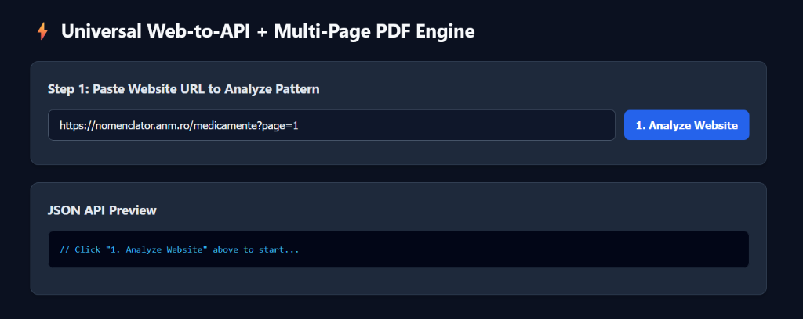
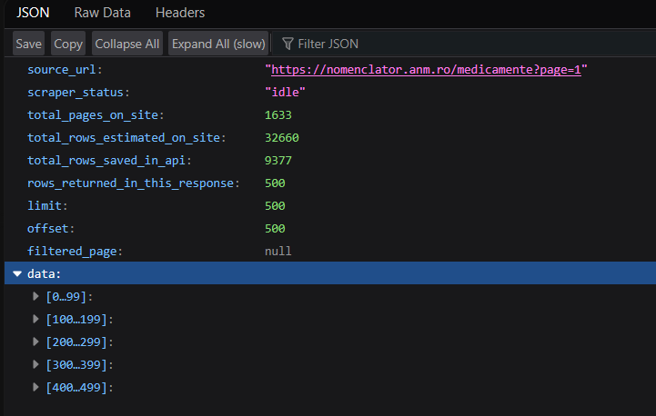
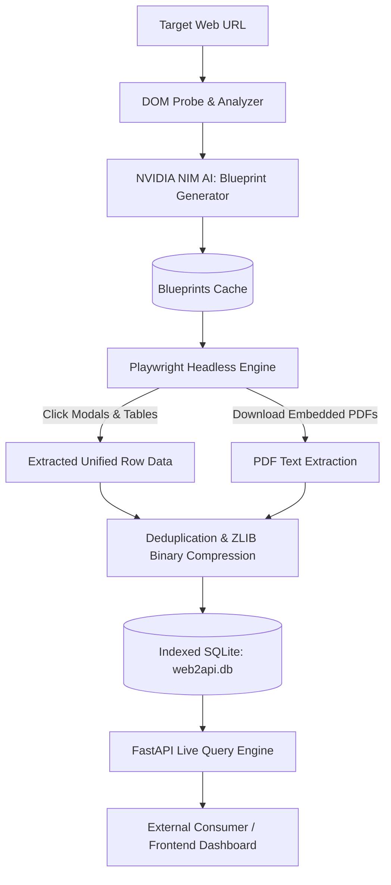

# ⚡ Web2API Engine + Multi-Page PDF Engine

> **Reverse-engineer any paginated website, dynamic data table, modal dialog, and multi-page PDF document into an instant, high-performance REST API.**

[](https://web2api-engine.onrender.com/)
[](https://www.python.org/)
[](https://fastapi.tiangolo.com/)
[](https://playwright.dev/)
[](https://www.docker.com/)
[](https://build.nvidia.com/)

---

## 🌐 Live Production Deployment

- **Live URL**: [https://web2api-engine.onrender.com/](https://web2api-engine.onrender.com/)
- **Interactive UI Dashboard**: [https://web2api-engine.onrender.com/](https://web2api-engine.onrender.com/)
- **Live REST API Endpoint Example**: `https://web2api-engine.onrender.com/api/v1/live/nomenclator_anm_ro?limit=100&offset=0`

---

## 📸 Visual Previews

### 1. Interactive Web Dashboard
Paste any paginated target URL to analyze its DOM structure, modal patterns, and pagination selectors automatically.


### 2. High-Performance Live REST API (Instant JSON)
Reads directly from indexed, deduplicated binary storage with zero waiting time, supporting pagination (`limit`, `offset`), page filtering, and embedded multi-page PDF extraction.


---

## 🚀 Key Features

- **Autonomous AI Blueprint Generation**:
  - Leverages **NVIDIA NIM** (`nvidia/nemotron-3.5-super-vl-120b-a12b` or `meta/llama-3.3-70b-instruct`) to autonomously generate precise CSS extraction blueprints for complex paginated tables, modal popups, and embedded file downloads.
  - Caches blueprints in `blueprints_cache/` for instant subsequent executions.

- **Deep Multi-Page & PDF Extraction**:
  - Automatically clicks and extracts data from dynamic JavaScript modals and popups.
  - Downloads and extracts embedded multi-page PDFs in real-time, normalizing and organizing document text seamlessly.

- **High-Performance Background Scraper**:
  - Non-blocking asynchronous scraping pipeline that persists rows incrementally to SQLite disk storage.
  - Zero RAM spikes or memory leaks, ensuring the API stays responsive even while scraping tens of thousands of rows.

- **Super-Shrunk Deduplicated Binary Storage**:
  - Custom ZLIB binary compression (`compress_blob`) and automatic PDF deduplication (`pdf_blobs`).
  - **Saves >94% disk space** (reduced an 867.2 MB database down to **50.58 MB** for 9,377+ rows and 4,880 unique PDFs).
  - Cleanly stays under GitHub's 100 MB per-file limit without third-party LFS dependencies.

- **Live REST API for External Apps**:
  - Immediate querying via `GET /api/v1/live/{endpoint_id}` while scraping is active or completed.
  - Supports `limit`, `offset`, `page`, and full-text `search` filters.

- **Production-Ready Containerization**:
  - Pre-configured `Dockerfile` based on Microsoft Playwright Ubuntu Jammy.
  - 1-click cloud deployment via `render.yaml`.

---

## 🛠️ Architecture & Workflow



---

## 📡 API Reference

### 1. Web Dashboard
`GET /`
- Returns the interactive dark-mode dashboard for analyzing websites, starting background jobs, and inspecting live responses.

---

### 2. Discover / Analyze Website
`POST /api/v1/discover`
- Probes target website, detects pagination parameters, generates AI blueprint, and returns a verified 1-row preview.

**Request Body:**
```json
{
  "url": "https://nomenclator.anm.ro/medicamente?page=1",
  "force_reanalyze": false
}
```

**Response Sample:**
```json
{
  "source_url": "https://nomenclator.anm.ro/medicamente?page=1",
  "endpoint_id": "nomenclator_anm_ro",
  "live_api_url": "https://web2api-engine.onrender.com/api/v1/live/nomenclator_anm_ro",
  "total_pages_detected": 1633,
  "rows_per_page": 20,
  "total_rows_estimated": 32660,
  "sample_preview_row": {
    "row_index": 1,
    "page_number": 1,
    "summary_table": { ... },
    "detail_modal": { ... },
    "documents_pdf": { ... }
  }
}
```

---

### 3. Start Background Scraper Job
`POST /api/v1/jobs/start`
- Launches a non-blocking background crawler task across pages, streaming rows directly into SQLite.

**Request Body:**
```json
{
  "url": "https://nomenclator.anm.ro/medicamente?page=1",
  "start_page": 1,
  "pages_to_scrape": 50,
  "rows_override": 1000
}
```

---

### 4. Check Scraper Progress
`GET /api/v1/jobs/status/{endpoint_id}`
- Returns real-time execution statistics (current page, rows scraped, target count, status).

---

### 5. Live Cached REST API (Blazing Fast)
`GET /api/v1/live/{endpoint_id}`
- Queries cached data directly from indexed SQLite with instant sub-millisecond response times.

**Query Parameters:**
| Parameter | Type | Default | Description |
| :--- | :--- | :--- | :--- |
| `limit` / `rows` | `integer` | `100` | Maximum number of rows to retrieve (up to 100,000) |
| `offset` | `integer` | `0` | Number of rows to skip for pagination |
| `page` / `start_page`| `integer` | `null` | Filter by specific source website page number |
| `search` | `string` | `null` | Keyword search across row fields |

**Example:**
```bash
curl -X GET "https://web2api-engine.onrender.com/api/v1/live/nomenclator_anm_ro?limit=10&offset=0"
```

---

## 💻 Local Development Setup

### 1. Clone Repository
```bash
git clone https://github.com/dontmindaditya/web2api-engine.git
cd web2api-engine
```

### 2. Create Virtual Environment & Install Dependencies
```bash
python -m venv venv
# On Windows:
.\venv\Scripts\activate
# On Linux/macOS:
source venv/bin/activate

pip install -r requirements.txt
playwright install chromium
```

### 3. Configure Environment Variables
Create a `.env` file in the project root:
```env
NVIDIA_API_KEY=your_nvidia_api_key_here
NVIDIA_BASE_URL=https://integrate.api.nvidia.com/v1
NVIDIA_MODEL=nvidia/nemotron-3.5-super-vl-120b-a12b
```

### 4. Run Development Server
```bash
uvicorn app.main:app --host 0.0.0.0 --port 8000 --reload
```
Open [http://localhost:8000](http://localhost:8000) in your browser.

---

## 🗜️ Database Optimization (`shrink_867mb.py`)

The included [shrink_867mb.py](shrink_867mb.py) utility compresses raw SQLite dumps into ultra-compact deduplicated binary BLOBs:
```bash
python shrink_867mb.py
```
- **Old Size**: 867.20 MB
- **New Size**: 50.58 MB (**94.2% reduction**)
- Automatically verifies row counts and transparently deduplicates repeated PDF payloads into `pdf_blobs`.

---

## 🐳 Docker & Cloud Deployment (Render)

This repository includes turnkey configuration for Render via [render.yaml](render.yaml):

1. Fork or push this repository to GitHub.
2. In Render, select **Blueprints** -> **New Blueprint Instance**.
3. Select this repository; Render will automatically detect [render.yaml](render.yaml) and [Dockerfile](Dockerfile).
4. Provide your `NVIDIA_API_KEY` when prompted.
5. Deploy!

---

## 📄 License

Distributed under the MIT License. See `LICENSE` for more information.
